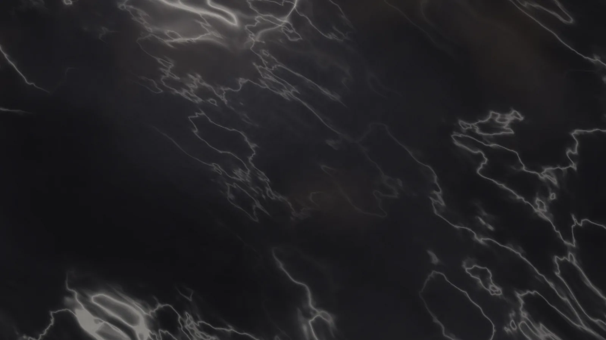

# hyprns

Live Navier–Stokes wallpapers drawn by Hyprland itself.

hyprns is a Hyprland plugin. On every monitor it runs a lattice Boltzmann fluid on the
GPU and draws a picture from it behind your windows, at the wallpaper's place in the
render (no extra surface, no client program). It has four looks:

| | |
|---|---|
|  |  |
| `pattern`: a reaction–diffusion web stirred by the fluid, espresso to brass | `embers`: coals seen from above, a coral glow in creeping cracks |
|  |  |
| `marble`: black marble leaned on by the fluid, veins that come and go | `jupiter`: a dark banded planet, storm outbreaks, a recurring eye, camera grain |

Each look never repeats: the fluid is chaotic, and every look's events (storms, veins,
flares) follow a schedule seeded per monitor, so two monitors with the same look differ.
A GPU time budget per monitor keeps the cost down on slower GPUs (see "Cost").

## Requirements

- Hyprland 0.56.2. The plugin is built and tested against 0.56.2 only. The plugin API is
  not stable between releases: other versions may not build.
- A GPU and driver with OpenGL ES 3.2, which is what Hyprland renders with.
- The Hyprland headers (`pkg-config hyprland`), pixman, libdrm, a C++23 compiler (built with
  GCC), make.
- For the bench and tests (optional): EGL, GLESv2 and libpng development files; the test
  scripts also use `jq`, `python3` with Pillow, and (`nested.sh grab`) `grim`.

The plugin must be rebuilt after every Hyprland update: a plugin built against other
headers would crash the compositor, so it refuses to load (with a notification) when the
running Hyprland is not the one it was built for.

**Tested on one machine only:** the author's PC (an NVIDIA RTX 4090 and the AMD integrated
GPU of a Ryzen 9 7950X, two monitors: 3440x1440 and a 1440x2560 portrait one). It has not
been tried on any other machine, GPU or driver.

**On integrated graphics, the default budget fits no look.** `budget_ms = 2` is sized for
a discrete GPU. On the integrated GPU above, every look costs more than 2 ms even at the
lowest quality: 2.7 to 7.1 ms per frame at 1440x2560 and 3.5 to 10.1 ms at 3440x1440
(`quality = 0.35`), and 5.6 to 18.2 ms at full quality. So the controller ends at its
lowest level and `status` says `over budget`. To lower the load:

- set `budget_ms` to what you can spare: about 5 for `pattern` or `marble` (they settle
  at q 0.5), 8 for `jupiter`, 11 for `embers` (q 0.35); or set `quality` yourself;
- lower `fps` (the fluid keeps its pace, the frames come less often);
- set `blur_fps` to a few frames a second, or 0, if you use translucent windows with
  Hyprland's blur (see "Blur behind windows");
- draw on fewer monitors (`monitors`);
- `time_scale = 0` freezes the picture: once it is whole, no frames at all, except
  `jupiter`'s grain. `marble` and `embers` take about a second of frames to bake their
  picture first, after loading, a look switch, a reset or a monitor change.

The tables under "Cost" give each look's cost at each quality.

## Install on Omarchy

On Omarchy (the Quattro shell) hyprns installs as a shell plugin. The shell plugin is
a small service (`omarchy/Service.qml`) that builds `hyprns.so` in `~/.cache/hyprns`
and loads it into Hyprland. It does not edit any of your config files.

```sh
omarchy plugin add https://github.com/cristianmoroaica/hyprns --enable
```

The first start compiles the plugin with all cores at low priority (about 10 seconds
on a 16-core desktop CPU, 80 seconds on one core). A notification, "Installing
hyprns", stays up while it builds and turns into "hyprns is running" when the
wallpaper switches over. After `omarchy plugin update`, or when Hyprland refuses the old
build after a Hyprland update, it rebuilds the same way ("Updating hyprns"). A
failed build or load ends with a notification that says why; the log is in
`~/.local/state/hyprns/omarchy-load.log`. At later logins it loads silently.

What you see: `omarchy plugin add` makes the shell reload its plugins once, as it does
for every plugin, so the bar redraws once. The wallpaper switches to the live one once,
when the plugin loads; Hyprland reloads its config by itself at that moment. The build
writes nothing into the plugin folder (the shell reloads every plugin on each file
written there), and restarting the shell does not unload or reload hyprns.

Settings go in your Hyprland config as described under "Config"; Hyprland applies them
when the plugin loads.

Requirements are the same as for building by hand (see "Requirements"): the Hyprland
headers, pixman, libdrm, GCC with C++23 and make. On Arch: `sudo pacman -S --needed
base-devel pixman libdrm` (the headers come with the `hyprland` package).

Remove it:

```sh
omarchy plugin remove io.github.cristianmoroaica.hyprns
```

Disabling or removing the shell plugin unloads hyprns from Hyprland a few seconds later,
and Hyprland's own wallpaper (or the shell's background) shows again. Do not also load
hyprns another way (hyprpm, `hl.plugin.load`): the service leaves an hyprns that is
already loaded alone.

## Build and load

```sh
make                         # builds hyprns.so
hyprctl plugin load "$PWD/hyprns.so"
hyprctl hyprns status
```

`hyprctl plugin unload "$PWD/hyprns.so"` removes it. To load it at every login, add it to
your config: `hl.plugin.load("/path/to/hyprns.so")` in a Lua config,
`plugin = /path/to/hyprns.so` in a hyprlang one.

With hyprpm (it reads `hyprpm.toml` at the repository's root and builds there with
`make all`):

```sh
hyprpm update
hyprpm add https://github.com/cristianmoroaica/hyprns
hyprpm enable hyprns
hyprpm reload
```

`hyprpm update` rebuilds it after a Hyprland update.

How this was checked: hyprpm 0.56.2 (built from the Hyprland source) ran `update`, `add`
and `enable` on the URL above, and the file it built loaded and ran in a nested Hyprland
0.56.2. That ran in a sandbox with a private `/var/cache/hyprpm` and a stand-in for
`sudo`, so hyprpm's own load step could not reach the file and it was loaded by hand; an
install on a normal system with real `sudo` has not been tried. Loading the 0.56.2 build into a Hyprland 0.56.1 was
tried too: it is refused with "version mismatch" and Hyprland keeps running.

## Config

Every key, with its default, is in [`hyprns.lua`](hyprns.lua): copy the block into your
Lua config after the plugin is loaded. The keys are registered as `plugin:hyprns:KEY`.

A hyprlang config takes the same keys in a `plugin` block (checked on 0.56.2), after
`plugin = /path/to/hyprns.so`:

```ini
plugin {
    hyprns {
        look = marble
        budget_ms = 3
    }
}
```

| Key | Default | Meaning |
|---|---|---|
| `enabled` | `1` | 0 or 1: draw the wallpaper at all |
| `monitors` | empty | connector names, comma separated; empty = every monitor |
| `fps` | `30` | 1 to 240: how often the wallpaper is redrawn |
| `look` | `pattern` | `pattern`, `embers`, `marble` or `jupiter`, on every monitor |
| `monitor_looks` | empty | `CONNECTOR:look` pairs that override `look`, e.g. `DP-4:marble,HDMI-A-1:jupiter` |
| `time_scale` | `1` | 0 to 4: multiplies every look's pace; 0 freezes |
| `budget_ms` | `2` | 0 to 50: GPU time per frame per monitor the controller holds (the plugin's own work, not Hyprland's blur); 0 turns the controller off |
| `quality` | `1` | 1, 0.75, 0.5 or 0.35: the picture's resolution as a fraction of the monitor's; with the controller on, where it starts and the highest it goes |
| `blur_fps` | `-1` | -1 to 240: how often Hyprland's blur behind translucent windows follows the wallpaper; -1 = with every wallpaper frame, 0 = never, N = at most N times a second (every k-th wallpaper frame, k = `fps` / N rounded up; so 20 at 30 fps gives 15). See "Blur behind windows" |

Changing the look (`look`, `monitor_looks`) fades the picture out over 0.4 s, switches,
and fades the new look in over 0.4 s.

A key the plugin does not have is refused like any other unknown key: Hyprland reports
it as a config error, and `hyprctl hyprns set` answers `unknown setting` with the list
of keys.

### The budget

With `budget_ms` above 0, the plugin measures each monitor's GPU time per frame (timer
queries) and steps the picture's resolution down through the four `quality` levels until
the mean fits, then slows the look's pace if even 0.35 does not; it steps back up when
there is room. The fluid lattice of every look always runs at full resolution: only the
picture (and `jupiter`'s cloud field) is made smaller and stretched. `hyprctl hyprns
status` shows the level each monitor settled at, and `over budget: raise budget_ms or
lower fps` when even the lowest level does not fit.

The budget counts only the plugin's own GPU work. The blur Hyprland redoes behind
translucent windows because the wallpaper changed is Hyprland's work: the budget does
not see it, and `status` does not show it (see "Blur behind windows").

### Blur behind windows

With `decoration:blur:new_optimizations` on (Hyprland's default), Hyprland blurs tiled
windows from a cached, blurred copy of each monitor's wallpaper and background layers.
It rebuilds that cache only when told the background changed. The plugin tells it with
every wallpaper frame (`blur_fps = -1`), so the blur behind windows moves with the
wallpaper.

Hyprland then rebuilds the cache in that frame when it judges something may read it:
- the monitor's active workspace shows a tiled window (or, with `xray`, any window) whose
  blur is on and that is not fully opaque: opacity below 1 (an `opacity` window rule
  counts), a surface Hyprland counts as small, or an opaque region that does not cover
  the whole window (rounded corners, client-side shadows, or a program that does not
  declare one);
- or any layer surface with an `xray` rule exists, on any monitor.

Each rebuild is one full blur of the monitor (`decoration:blur:passes`), whether or not
anything on screen samples it. With `blur_fps = -1` that is one blur per wallpaper frame:
`fps` a second, or the monitor's refresh rate if that is lower. When nothing qualifies, it
costs nothing.

`blur_fps = N` refreshes the cache at most N times a second, on every k-th wallpaper frame
(k = `fps` / N, rounded up): the blur behind windows then moves in steps, the wallpaper
itself does not. When the picture freezes (`time_scale = 0`), its last frame refreshes
the cache once more. `blur_fps = 0` never refreshes it from the
plugin's frames: the blur shows the wallpaper as it was when Hyprland last refreshed the
cache for its own reasons (a window opened or moved, a workspace switch), and when the
plugin is loaded, unloaded or a setting changes. With `xray = 1` and
`new_optimizations = 0`, Hyprland never refreshes the cache at all (also without this
plugin), so the blur stays stale whatever `blur_fps` says.

## Commands

```sh
hyprctl hyprns status        # per monitor: look (and why it failed, if it did), lattice, q, GPU ms/frame, resets; then every key
hyprctl -j hyprns status     # the same as JSON
hyprctl hyprns set KEY VALUE # change one key live, until the next config reload
hyprctl hyprns reset         # restart every monitor's fluid from rest
```

## Cost

All numbers below were measured on the author's machine only (see "Requirements"), on
2026-11-16. What was not measured is said in each part. They were taken on the build
before the current frame pacing (commit `be5a595`: before `blur_fps`, the 0.4 s fade and
"only timer frames move the picture"). The bench's GPU times per frame do not depend on
that pacing; they were measured again on the current build for the integrated GPU at
3440x1440 q 1 and came out the same ("GPU time per frame"). The nested-Hyprland figures
(blur cost, memory, power, stability) were not taken again.

### GPU time per frame

Measured with `test/gpucost.sh`: the bench's GPU timer queries, 30 fps, the GPU otherwise
idle, three runs per cell. Each cell is the mean of the three run means in ms, then the
largest single frame of all runs in brackets. No cell's runs differ by more than 15 % of
its mean. The fluid lattice runs at full resolution at every quality: `quality` scales the
picture (and `jupiter`'s cloud field), so lowering it saves less than its square.

NVIDIA RTX 4090, 3440x1440:

| look | q 1 | q 0.75 | q 0.5 | q 0.35 |
|---|---|---|---|---|
| pattern | 0.162 (0.96) | 0.150 (0.87) | 0.124 (0.82) | 0.115 (0.78) |
| embers | 0.316 (0.95) | 0.286 (1.02) | 0.250 (0.84) | 0.237 (0.67) |
| marble | 0.133 (0.76) | 0.120 (0.57) | 0.098 (0.54) | 0.091 (0.67) |
| jupiter | 0.218 (0.66) | 0.193 (0.63) | 0.162 (0.63) | 0.151 (0.64) |

NVIDIA RTX 4090, 1440x2560 (portrait):

| look | q 1 | q 0.75 | q 0.5 | q 0.35 |
|---|---|---|---|---|
| pattern | 0.136 (0.59) | 0.125 (0.57) | 0.108 (0.55) | 0.099 (0.56) |
| embers | 0.255 (1.05) | 0.235 (0.91) | 0.209 (0.89) | 0.201 (0.86) |
| marble | 0.107 (0.76) | 0.098 (0.76) | 0.082 (0.74) | 0.078 (0.77) |
| jupiter | 0.172 (0.84) | 0.157 (0.87) | 0.136 (0.83) | 0.126 (0.82) |

AMD integrated graphics of a Ryzen 9 7950X (2 compute units, Mesa radeonsi), 3440x1440:

| look | q 1 | q 0.75 | q 0.5 | q 0.35 |
|---|---|---|---|---|
| pattern | 7.653 (9.44) | 6.061 (7.99) | 4.384 (6.21) | 3.644 (4.74) |
| embers | 18.231 (24.22) | 14.583 (21.92) | 11.688 (17.06) | 10.148 (15.81) |
| marble | 8.634 (12.64) | 6.491 (9.43) | 4.323 (7.65) | 3.487 (5.54) |
| jupiter | 14.029 (21.87) | 10.718 (16.31) | 8.238 (11.55) | 7.118 (12.95) |

The same integrated GPU, 1440x2560 (portrait):

| look | q 1 | q 0.75 | q 0.5 | q 0.35 |
|---|---|---|---|---|
| pattern | 5.647 (6.75) | 4.453 (5.94) | 3.254 (4.58) | 2.707 (4.21) |
| embers | 13.171 (17.26) | 10.424 (13.17) | 8.105 (10.70) | 7.127 (9.60) |
| marble | 6.266 (9.31) | 4.666 (6.78) | 3.233 (4.17) | 2.662 (4.27) |
| jupiter | 9.993 (13.48) | 7.703 (11.16) | 6.019 (9.76) | 5.083 (7.60) |

On the 4090 every look costs a fraction of a millisecond. On the integrated GPU none fits
the default `budget_ms = 2`, even at q 0.35: see "Requirements" for what to set there.
These are the bench's numbers, not the plugin's inside Hyprland, and they do not include
Hyprland's own blur ("Blur cost" below). Not measured: a GPU busy with other work (an
earlier build with a second program drawing on the same GPU took 1.3 to 2.4 times as long
on the 4090, and was no slower on the integrated GPU), and any GPU other than these two.

### Blur cost

Measured in a nested Hyprland (`test/nested.sh`) on the 4090: blur on (size 4, 3 passes),
`pattern` at q 1, with and without one translucent tiled window. The nested output is
720x1280 and ran at 15 fps (the host throttles it), not a desktop size or rate.
- Hyprland's CPU-side render time (`debug:overlay`) rose by about 0.05 to 0.12 ms per
  frame with the window, about as much as its frame-to-frame spread. This is the time
  Hyprland spends issuing the frame, not the GPU's time: the GPU runs the blur later.
- `nvidia-smi` (once a second, with other programs on the same GPU) showed no difference
  in GPU use or power; it cannot see differences that small.

On the real desktop (4090, 3440x1440 and 1440x2560, `jupiter`, fps 30, blurred layers on
screen, another program drawing on the same GPU): Hyprland's own GPU share
(`nvidia-smi pmon`) over 24 pairs of 8 s, `blur_fps = -1` against `0`, was 20.8 % against
20.5 %: a difference of 0.3 ± 1.9 points (standard error), which is 0.1 ± 0.6 ms per
wallpaper frame. So on this GPU the re-blur costs at most about 1.4 ms per frame, and
most likely far less; the measurement cannot say more.

Not measured more exactly: the GPU time of the re-blur itself, the blur at 60 fps or
more, and any blur cost on the integrated GPU (no session can be run on it here). A full-monitor blur on an integrated
GPU may well cost a large part of a millisecond or more per frame; `blur_fps` is the
lever if it does.

### Video memory

Computed from the code (texture sizes only), in MiB:

| look | 3440x1440 q 1 | q 0.75 | q 0.5 | q 0.35 | 1440x2560 q 1 | q 0.75 | q 0.5 | q 0.35 |
|---|---|---|---|---|---|---|---|---|
| pattern | 16.7 | 27.3 | 21.4 | 19.0 | 12.4 | 20.3 | 15.9 | 14.1 |
| embers | 74.3 | 60.1 | 36.5 | 26.9 | 55.3 | 44.7 | 27.2 | 20.0 |
| marble | 83.0 | 66.2 | 40.8 | 30.4 | 62.2 | 49.5 | 30.4 | 22.6 |
| jupiter | 27.8 | 31.9 | 21.4 | 17.1 | 20.6 | 23.7 | 15.9 | 12.7 |

`pattern` and `jupiter` take more at q 0.75 than at q 1: below q 1 the plugin adds a
picture target, and these two looks have no large picture-sized textures that shrink to
make up for it. While the quality changes, `embers` and `marble` briefly hold their old
textures too: up to about 38 and 42 MiB more at 3440x1440.

Measured with `nvidia-smi` on the 4090, in MiB:

| look | bench, 3440x1440 q 1 | bench, q 0.5 | bench, 1440x2560 q 1 | bench, q 0.5 | nested Hyprland, 720x1280 q 1 |
|---|---|---|---|---|---|
| pattern | 94 | 106 | 61 | 69 | +15 |
| embers | 157 | 121 | 110 | 82 | +28 |
| marble | 198 | 146 | 112 | 96 | +37 |
| jupiter | 116 | 103 | 77 | 69 | +28 |

The bench numbers are the whole bench process (about 20 MiB of it is there with a tiny
output, and it has its own output image the plugin does not have). The nested column is
what loading the plugin added to a nested Hyprland. Measured is 1.2 to 1.4 times the
computed figure inside Hyprland, and 1.3 to 2.7 times in the bench after taking off the
bench's own 19 to 26 MiB; the gap is
unexplained (driver padding or allocation granularity are guesses, not findings). Not
measured: the plugin at 3440x1440 or 1440x2560 inside a real session, and anything on the
integrated GPU.

### Power

Not resolved. In a nested Hyprland on the 4090 (720x1280, 15 fps, `pattern` q 1), board
power with the plugin loaded could not be told apart from unloaded: other programs on the
same GPU moved it by several watts and in bursts up to about 200 W. The plugin's share of
the GPU was about 1 %, which on a 4090 is on the order of 1 W or less. Not measured: power
at desktop size and rate, and any power figure on the integrated GPU.

### Stability

In a nested Hyprland on the 4090: 10 minutes of each look, then 10 unload/load cycles,
with no crash and no fluid reset. Process memory stayed flat (one step of 2 MiB once, in
the `jupiter` run, cause not found); video memory went back to the same level after every
unload. The fluid of every look keeps its mass (`test/mass.sh`: within 2e-7 after 500 000
steps on the 4090, within 1.3e-6 after 100 000 on the integrated GPU).

## Troubleshooting

**A notification says a look failed (for example a shader was rejected).** The driver
refused one of the look's shaders or textures. The plugin shows `pattern` on that monitor
instead, or `marble` when `pattern` fails too. The notification and `hyprctl hyprns
status` say which look failed, why, and what is shown (`embers failed: ...; showing
pattern: ...`; in the JSON, `look` is the look asked for, `shown` the one drawn and
`error` the reason). When nothing builds, the plugin draws nothing on that monitor and
Hyprland's own background shows, until the look, the size or the quality changes, or
`hyprctl hyprns reset` tries again. Report the message with your GPU and driver.

**A notification says hyprns was not loaded: built for another Hyprland.** The plugin was
built against other Hyprland headers than the running Hyprland's. Rebuild it (`make`, or
`hyprpm update`) and load it again.

**Nothing changes on screen, but `status` shows the look running.** Another program is
drawing an opaque surface on the bottom or background layer over the wallpaper (a
wallpaper daemon such as hyprpaper or swaybg, or a shell's own background). Stop it or
make its background transparent: hyprns draws where Hyprland draws its wallpaper, below
every layer surface.

**A glass or blur plugin shows a stale wallpaper behind windows.** Plugins that re-sample
what is behind a surface only when that surface commits do not see a wallpaper that
changes on its own. Turn on their live re-sampling, e.g. for hyprglass
`layers.force_live_resample = 1`.
Hyprland's own blur (`decoration:blur` with `new_optimizations` on, its default) needs
nothing: the plugin marks the monitor's blur cache stale with each wallpaper frame. When
that costs too much, lower `blur_fps`; "Blur behind windows" says when Hyprland re-blurs.

**The GPU is slow, or the fans spin up.** Lower `budget_ms` (the controller lowers the
picture's resolution, then the pace, to stay under it), set `quality` with `budget_ms = 0`
to choose the resolution yourself, or lower `fps`: the fluid keeps its pace, but the
picture and the per-frame passes run fewer times a second. (At `quality` 1, a redraw
Hyprland makes for its own reasons, such as a video in a window, still draws the look's
picture pass, and `budget_ms` does not count it; below 1 such a redraw only stretches the
last picture.) With translucent windows and
Hyprland's blur, also lower `blur_fps` (or set it to 0): that blur is Hyprland's GPU time,
which `budget_ms` does not count. `monitors` limits the plugin to some monitors,
`time_scale = 0` freezes the picture (no frames once it is whole, except `jupiter`'s
grain), and
`enabled = 0` stops it.

**`jupiter` on a portrait monitor shows 13 bands, on a landscape one fewer.** By design:
the number of jets follows the lattice's height.

**Below quality 2/3, `jupiter`'s grain looks coarser.** By design: the grain is one value
per picture pixel, and below 2/3 a picture pixel covers more than one screen pixel.

**`status` counts `resets`.** A look whose fluid reaches its health limit (a speed or
density out of range, or a NaN) restarts itself from rest; the count says how often. A
count that keeps growing is a bug worth reporting.

**`jupiter`'s rotation looks too exact.** Its rotation term is an exact rotation of the
velocity, not the usual first-order force: the first-order term gains energy every step
and eventually blows the lattice up.

## Tests

```sh
make test                                   # host unit tests, no GPU
make bench                                  # build/hyprns-bench: the looks without Hyprland (headless EGL)
build/hyprns-bench --look marble --size 3440x1440 --time
test/gpucost.sh --device /dev/dri/renderD128 --size 3440x1440
test/mass.sh                                # every look's fluid keeps its mass over a million steps
test/stills.sh marble 2400                  # build/stills/marble-plugin.png next to the sketch's still
test/nested.sh start; test/soak.sh 10; test/nested.sh stop   # a nested Hyprland: never the session you are in
                                            # soak.sh 10: 10 min per look, about 45 min in all
```

The GPU scripts take the render node from `--device` or `$HYPRNS_DEVICE`, else
`/dev/dri/renderD128`, which on a machine with two GPUs is whichever enumerated first:
check `ls -l /dev/dri/by-path`. `nested.sh` starts the nested Hyprland through the
host's `hl.dsp.exec_cmd` (a host with a Lua config) and puts its window on the host's
workspace 10.

## Licence

BSD 3-Clause, see [LICENSE](LICENSE).
